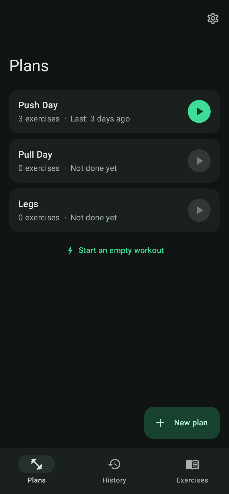
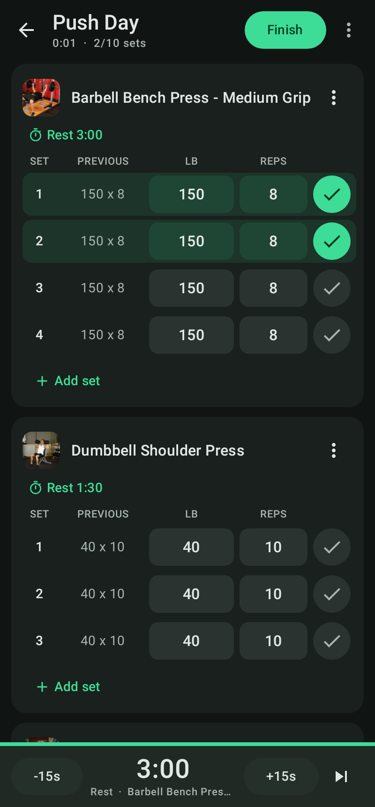
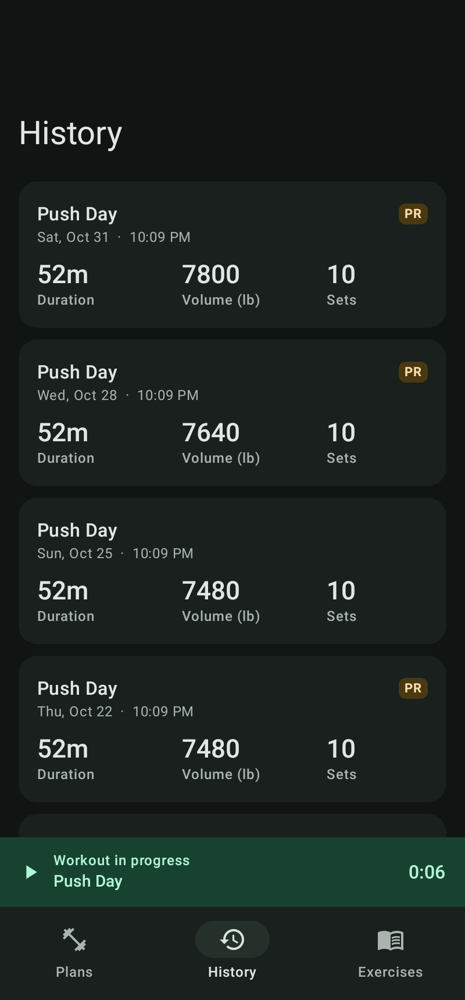
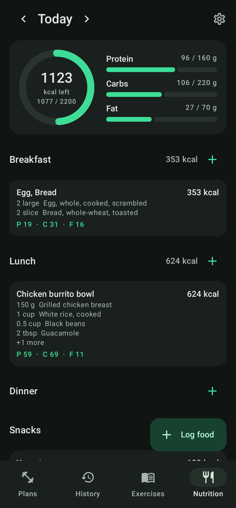
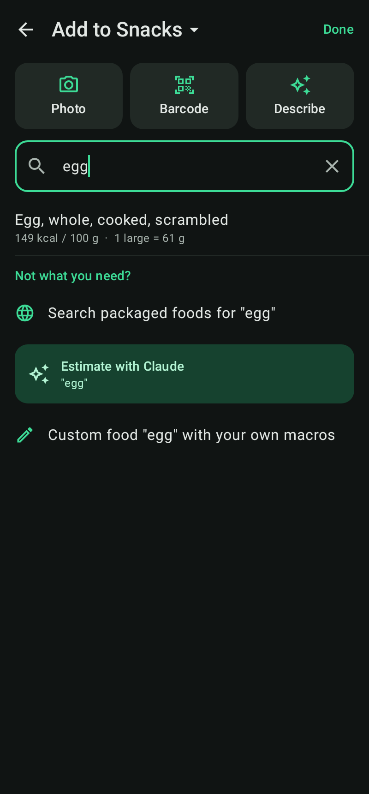
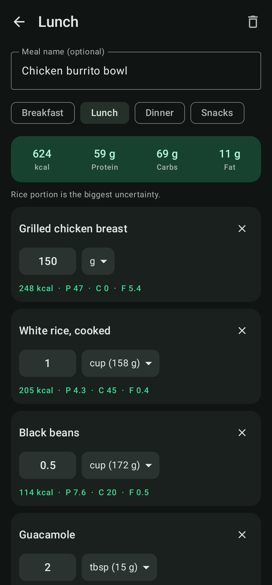

# Liftlog

A simple Android workout and nutrition tracker. Build plans, start one, tick off each set, and a rest timer counts down
to your next set. Log what you eat by searching foods, scanning a barcode, describing it, or snapping a photo.

<p>



</p>

## Features

- **Plans**: named lists of exercises. Each exercise has target sets x reps @ weight (per-set overrides) and its own rest time.
- **Workouts**: start a plan and every set is pre-filled. Tap the check to mark a set done and the rest timer starts.
  The "Previous" column shows what you lifted last time; tap it to copy those numbers.
- **Rest timer**: bar at the bottom of the workout (+/-15s, skip). It keeps running with the screen off, shows a
  countdown notification and vibrates when rest is over.
- **Progression**: after finishing a workout the lifted weights become the plan's new targets (can be turned off in Settings).
- **Exercise library**: 1,324 exercises from [exercises-dataset](https://github.com/hasaneyldrm/exercises-dataset)
  (data MIT licensed, see `app/src/main/assets/licenses/`) with animated demos, target and secondary muscles, equipment
  and step-by-step instructions. Search and filter by muscle / equipment. Add your own custom exercises.
  Exercise animations and thumbnails are © Gym visual — https://gymvisual.com/, used under license; they are not
  stored in this repository but loaded by the app at runtime. Rebuild the data with `python3 tools/build_exercises.py`.
- **History and PRs**: past workouts with duration, volume and sets; per-exercise history with a progress chart
  (top weight, estimated 1RM, volume). Sets that beat your best weight or estimated 1RM get a PR badge.
- lb by default, kg available. All data stays on the device (Room database).

### Nutrition

<p>



</p>

- **Daily view**: calories left against your goal, protein / carbs / fat bars, meals grouped into
  breakfast, lunch, dinner and snacks. Swipe through days with the arrows.
- **Search first**: about 7,800 generic foods from USDA FoodData Central (SR Legacy, public domain) are bundled,
  with real serving sizes ("1 large egg = 50 g"). Packaged foods come from Open Food Facts (search or barcode scan).
- **Claude fallback**: if a food is not in the database, "Estimate with Claude" turns plain text like
  "2 eggs scrambled in butter, 2 slices toast" into items with macros.
- **Photo**: take or pick a photo, add an optional note, and Claude estimates every item and its macros.
- **Always editable**: change any amount or unit and the macros recalculate instantly; rename items and tap
  Re-estimate to have Claude recompute them.
- **Custom foods** with your own macros per serving, and recently used foods for quick re-logging.
- Goals and your Anthropic API key are set in Settings. The key stays on the phone (excluded from backups).
  Claude requests use Haiku 5.5 by default (Sonnet 5.5 or Opus 5.5 selectable in Settings) with structured JSON output.

## Install

Every push to `main` builds an APK and attaches it to the
[latest release](../../releases/tag/latest). Download `liftlog.apk` on your phone and open it
(allow installing from unknown sources). Android 8.0+.

## Build

Requires JDK 17, Python 3 and the Android SDK (platform 35).

```bash
python3 tools/build_usda_foods.py   # downloads USDA data -> app/src/main/assets/foods.json (not committed)
./gradlew assembleRelease           # app/build/outputs/apk/release/app-release.apk
./gradlew testDebugUnitTest         # logic tests + renders screenshots to app/build/screenshots
```

### Release signing

Release APKs are signed with a fixed key so updates install over the previous version.
`signing/liftlog.jks.enc` is the keystore encrypted with AES-256; CI decrypts it with the
`LIFTLOG_KEYSTORE_PASSWORD` repository secret. Without that secret, CI still builds but does not publish.

## Structure

```
app/src/main/java/com/hectormtzm/liftlog/
  data/       Room entities, DAOs, repositories (plans, workouts, exercises, settings)
  data/nutrition/  foods, meals, Claude estimator, Open Food Facts client
  timer/      Rest timer state + foreground service (notification, vibration)
  ui/         Compose screens: plans, workout, exercises, history, nutrition, settings
```
