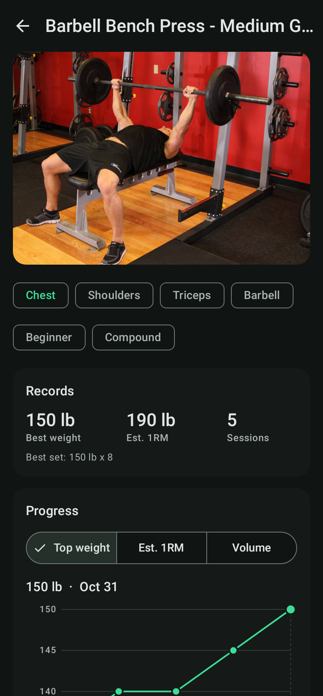

# Liftlog

A simple Android workout tracker. Build plans, start one, tick off each set, and a rest timer counts down to your next set.

<p>




</p>

## Features

- **Plans**: named lists of exercises. Each exercise has target sets x reps @ weight (per-set overrides) and its own rest time.
- **Workouts**: start a plan and every set is pre-filled. Tap the check to mark a set done and the rest timer starts.
  The "Previous" column shows what you lifted last time; tap it to copy those numbers.
- **Rest timer**: bar at the bottom of the workout (+/-15s, skip). It keeps running with the screen off, shows a
  countdown notification and vibrates when rest is over.
- **Progression**: after finishing a workout the lifted weights become the plan's new targets (can be turned off in Settings).
- **Exercise library**: 876 exercises from [free-exercise-db](https://github.com/yuhonas/free-exercise-db) (public domain)
  with photos, muscles, equipment and instructions. Search and filter by muscle / equipment. Add your own custom exercises.
- **History and PRs**: past workouts with duration, volume and sets; per-exercise history with a progress chart
  (top weight, estimated 1RM, volume). Sets that beat your best weight or estimated 1RM get a PR badge.
- lb by default, kg available. All data stays on the device (Room database).

## Install

Every push to `main` builds an APK and attaches it to the
[latest release](../../releases/tag/latest). Download `liftlog.apk` on your phone and open it
(allow installing from unknown sources). Android 8.0+.

## Build

Requires JDK 17 and the Android SDK (platform 35).

```bash
./gradlew assembleRelease        # app/build/outputs/apk/release/app-release.apk
./gradlew testDebugUnitTest      # logic tests + renders screenshots to app/build/screenshots
```

## Structure

```
app/src/main/java/com/hectormtzm/liftlog/
  data/       Room entities, DAOs, repositories (plans, workouts, exercises, settings)
  timer/      Rest timer state + foreground service (notification, vibration)
  ui/         Compose screens: plans, workout, exercises, history, settings
```

The database is designed so food tracking can be added later as its own set of tables and a new tab.
